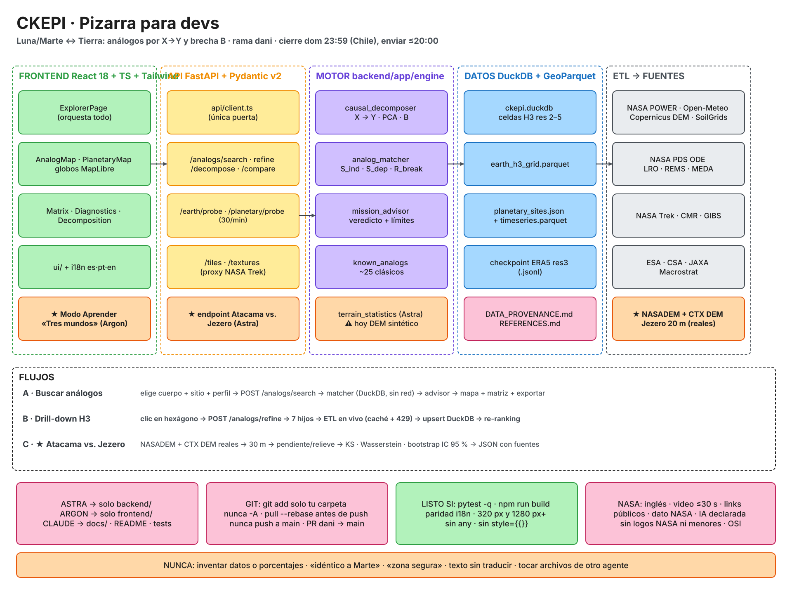
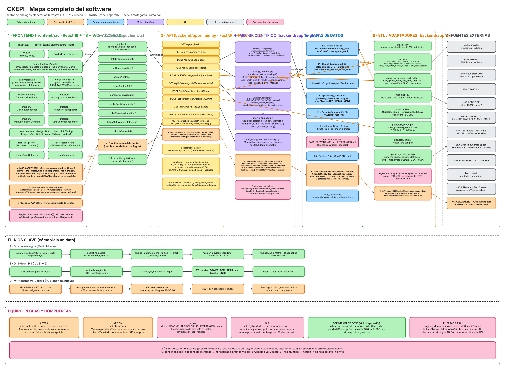
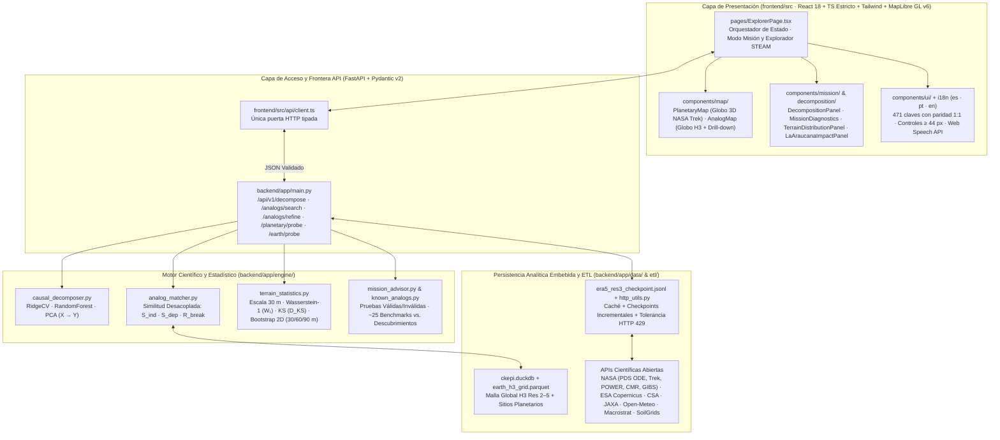

# Ckepi — Causal Variable Decomposition & Planetary Analog Discovery Engine (Earth · Moon · Mars)

[](#)
[](docs/DMP.md)
[](LICENSE)
[](backend/)
[](frontend/)
[-F59E0B?style=flat-square)](frontend/src/i18n/)

> **Desafío Oficial (NASA Space Apps Challenge 2026):** *Identify Earth Locations that Analog the Permanent Moon Base Locations and Mars*  
> **Sede Local:** Antofagasta, Chile (Universidad Católica del Norte · Organizado en Chile por **Caja La Araucana** junto a American Spaces)  
> **Equipo:** *Lattices Team* · **Rama activa de desarrollo:** `dani` (Entrega a `main` exclusivamente vía Pull Request auditado)

---

## Navegación Rápida

1. [Resumen Ejecutivo y Tesis Científica](#1-resumen-ejecutivo-y-tesis-científica)
2. [Qué es Medido, Derivado, Modelo o Sintético Calibrado (Ciencia Abierta FAIR)](#2-qué-es-medido-derivado-modelo-o-sintético-calibrado-ciencia-abierta-fair)
3. [Mapas de Arquitectura Excalidraw Desplegados](#3-mapas-de-arquitectura-excalidraw-desplegados)
4. [Formulación Matemática y Física del Motor ($X \rightarrow Y \parallel B$)](#4-formulación-matemática-y-física-del-motor-x--y--b)
5. [Modo Aprendizaje Accesible «Tres Mundos para Todos» e Impacto Local (Caja La Araucana · ODS)](#5-modo-aprendizaje-accesible-tres-mundos-para-todos-e-impacto-local-caja-la-araucana--ods)
6. [Fuentes de Datos Abiertos Multi-Agencia](#6-fuentes-de-datos-abiertos-multi-agencia)
7. [Plan Maestro de Ejecución y Gobernanza Multi-Agente](#7-plan-maestro-de-ejecución-y-gobernanza-multi-agente)
8. [Protocolo Obligatorio de Seguridad, Limpieza y Auditoría Pre-Subida (`ckepi-verify`)](#8-protocolo-obligatorio-de-seguridad-limpieza-y-auditoría-pre-subida-ckepi-verify)
9. [Inicio Rápido Local (Linux · macOS · Windows)](#9-inicio-rápido-local-linux--macos--windows)
10. [Índice de Documentación Técnica y Científica](#10-índice-de-documentación-técnica-y-científica)

---

## 1. Resumen Ejecutivo, Problema Real, Propuesta de Valor e Innovación

### ¿El problema es real?
**Sí.** La propia **NASA** reconoce en el desafío oficial que los análogos terrestres no están completamente caracterizados y que existen oportunidades reales para identificar nuevos lugares útiles para la exploración espacial (Luna y Marte). Realizar una comparación rigurosa requiere integrar múltiples fuentes de datos científicos a escala comparable y comprender con honestidad las limitaciones físicas de cada terreno.

### ¿Es importante y afecta a las personas?
**Sí, en dos niveles complementarios:**
1. **Investigadores e ingenieros espaciales/robóticos:** Necesitan información cuantitativa transparente y reproducible para orientar investigaciones preliminares y preparar ensayos de campo (tracción de rovers, sensores ópticos/LiDAR, geología).
2. **Estudiantes, familias y personas sin experiencia científica:** Existe una oportunidad educativa y social concreta para acercar estos conocimientos a las comunidades locales mediante herramientas comprensibles, accesibles y sin barreras digitales.

### Propuesta de Valor
**Ckepi** busca facilitar comparaciones científicas transparentes, orientar investigaciones preliminares y permitir que más personas aprendan con datos espaciales reales. Además, estudiamos **sectores poco caracterizados de la Región de Antofagasta y de otras regiones** (como *Salar de Pajonales* o *Cordillera de la Sal*, usando *Yungay* como control clásico) para identificar nuevas oportunidades de investigación científica y desarrollo territorial.

### Nuestra Propuesta de Innovación
> **«No queremos demostrar que Atacama es idéntico a Marte. Queremos mostrar qué características comparte, qué diferencias existen y qué nuevos lugares merecen ser estudiados utilizando evidencia científica.»**

Para materializar esta tesis, **Ckepi** integra dos experiencias sincronizadas sobre un mismo motor de ciencia abierta:

1. **Modo Misión (Investigación Preliminar e Ingeniería Planetaria):**
   - **Descomposición Causal Desacoplada ($X \rightarrow Y \parallel B$):** Separa estadísticamente **10 variables independientes de sustrato ($X$)**, **6 respuestas ambientales dependientes ($Y = f(X)$)** y **3 fronteras de ruptura física irreducible ($B$: gravedad superficial, presión atmosférica y radiación ionizante GCR/SEP)**.
   - **Indexación Global Hexagonal Uber H3 (Res 2 $\rightarrow$ Res 5):** Evalúa la superficie continental terrestre sobre DuckDB + GeoParquet, distingue entre **~25 análogos clásicos de literatura** (como Yungay en Atacama, McMurdo o Río Tinto) y **nuevos candidatos poco estudiados**, y permite subdividir cualquier celda en **7 sub-hexágonos hijos** en tiempo real.
   - **Comparación No Paramétrica de Distribuciones Topográficas (Escala Común $\ge 30\text{ m}$):** Compara distribuciones completas de pendiente (°) y relieve local ($\text{m}$, ventana $300\times 300\text{ m}$) mediante distancias formales **Wasserstein-1 ($W_1$)** y **Kolmogorov–Smirnov ($D_{\text{KS}}$)** con **intervalos de confianza al 95 % por bootstrap de bloques espaciales 2D** y análisis de sensibilidad a **30 m, 60 m y 90 m**.
2. **Modo Explorador STEAM / «Tres Mundos para Todos» (Alfabetización Científica y Baja Alfabetización Digital):**
   - Recorrido progresivo en 3 niveles (**Mirar $\rightarrow$ Comparar $\rightarrow$ Investigar**) con datos verificados de las **NASA Planetary Fact Sheets (NSSDCA)**, analogías cotidianas sin jerga, lectura en voz alta integrada (**Web Speech API `window.speechSynthesis`**), controles táctiles $\ge 44\text{ px}$ y fuente visible en cada tarjeta.

> [!IMPORTANT]
> **Regla de Honestidad Física No Negociable:** Ningún sitio en la Tierra es «idéntico» a la Luna o Marte. Todo resultado en Ckepi reporta su margen de incertidumbre, su resolución espacial efectiva y su **Brecha Física Irreducible ($B$)**. **Ckepi orienta investigaciones preliminares y preselecciona sitios para ensayos; no certifica seguridad operativa de vuelos ni de rovers.**

---

## 2. Qué es Medido, Derivado, Modelo o Sintético Calibrado (Ciencia Abierta FAIR)

Siguiendo los principios **FAIR** ([docs/DMP.md](docs/DMP.md)) y la trazabilidad exigida en [docs/DATA_PROVENANCE.md](docs/DATA_PROVENANCE.md), Ckepi declara con total transparencia el origen exacto de cada capa de datos en el estado actual del repositorio:

| Módulo / Variable | Origen en el Código Actual (`rama dani`) | Estado y Alcance Científico |
|---|---|---|
| **Clima y Radiación Terrestre (`solar_flux_wm2`, `surface_albedo`, `uv_irradiance_index`, `relative_humidity_pct`, `surface_wind_ms`)** | **Medido / Satelital** vía **NASA POWER API** (`Climatology 20+ yr ANN` y series diarias). | Telemetría satelital abierta real con caché y tolerancia a fallos. |
| **Pendiente y Rugosidad Base por Celda H3 (`slope_deg`, `topographic_roughness`)** | **Medido** vía **Open-Meteo Copernicus DEM 90m** (con fallback automático a **NASA/METI ASTER 30m DEM** vía OpenTopoData). | Calculado mediante stencil de diferencias finitas de 5 puntos ($\sim 3{,}3\text{ km}$). |
| **Ciclo Térmico Terrestre (`diurnal_temp_amplitude_k`, `nocturnal_cooling_k_hr`, `mean_surface_temp_k`)** | **Medido / Reanálisis** vía **Open-Meteo ERA5-Land Archive** + propiedades de suelo **ISRIC SoilGrids v2.0** (`0–5 cm`). | Pre-hidratado en `ckepi.duckdb` / `earth_h3_grid.parquet` y consultable en vivo. |
| **Sitios Curados en Marte (`mars_jezero_crater`, `mars_gale_crater`, `mars_arcadia_planitia`)** | **Medido + Derivado + Constantes Publicadas:** Clima por **NASA Curiosity REMS / Perseverance MEDA**; flujo solar por geometría orbital ($L_s$); relieve/hielo por referencias publicadas LOLA/MOLA/SHARAD. | Etiquetado variable por variable en `confidence.variable_provenance`. |
| **Sitios Curados en Luna (`moon_shackleton_pole`, `moon_tranquillitatis_lava`)** | **Medido + Modelo Físico:** Ventanas observacionales reales de **NASA PDS ODE (LRO Diviner / LOLA)** + equilibrio radiativo de Stefan-Boltzmann. | Etiquetado variable por variable en `confidence.variable_provenance`. |
| **Fichas «Tres Mundos para Todos» (Gravedad, Presión, Día Solar, Temperatura, Radiación)** | **Constantes Oficiales Verificadas:** **NASA NSSDCA Planetary Fact Sheets** + dosis de radiación superficial en Marte medida por **Curiosity/RAD** ($\sim 0{,}64\text{ mSv/día} \approx 230\text{ mSv/año}$; Hassler et al., 2014, *Science*). | Incluye el rango completo de temperatura media de Marte ($-59\text{ °C}$ en ficha individual y $-65\text{ °C}$ en tabla comparativa NASA). |
| **Comparación de Distribuciones Topográficas 30 m (`terrain_statistics.py`: $W_1$, $D_{\text{KS}}$, Bootstrap 2D)** | **Medido sobre DEM reales** (CTX DEM de Jezero, NASA MRO/USGS; Copernicus GLO-30, ESA) para Jezero, el control Yungay y 4 celdas de Antofagasta; otras combinaciones salen rotuladas `SYNTHETIC`. Resultados: [`docs/RESULTADOS_TERRENO_REALES.md`](docs/RESULTADOS_TERRENO_REALES.md). |

---

## 3. Mapas de Arquitectura Excalidraw Desplegados

### 3.1 Pizarra Operativa de Arquitectura y Flujos (`docs/MAPA_SOFTWARE_PIZARRA.excalidraw`)

> Archivo fuente editable en Excalidraw: [`docs/MAPA_SOFTWARE_PIZARRA.excalidraw`](docs/MAPA_SOFTWARE_PIZARRA.excalidraw) · Render vectorial desplegado: [`docs/MAPA_SOFTWARE_PIZARRA.svg`](docs/MAPA_SOFTWARE_PIZARRA.svg)

<p align="center">
  
</p>

### 3.2 Mapa Completo del Software de Extremo a Extremo (`docs/MAPA_SOFTWARE.excalidraw`)

> Archivo fuente editable en Excalidraw: [`docs/MAPA_SOFTWARE.excalidraw`](docs/MAPA_SOFTWARE.excalidraw) · Render vectorial desplegado: [`docs/MAPA_SOFTWARE.svg`](docs/MAPA_SOFTWARE.svg)

<p align="center">
  
</p>

### 3.3 Diagrama de Capas y Flujo de Datos (Mermaid)



---

## 4. Formulación Matemática y Física del Motor ($X \rightarrow Y \parallel B$)

Definida canónicamente en [`backend/app/config.py`](backend/app/config.py) y [`backend/app/engine/`](backend/app/engine/):

### 4.1 Las Tres Capas Físicas de Variables

| Capa | Variables en Código (`config.py`) | Significado Físico y Función |
|---|---|---|
| **1. Sustrato Independiente ($X$)** *(10 variables)* | `topographic_roughness`, `slope_deg`, `thermal_inertia`, `surface_albedo`, `solar_flux_wm2`, `subsurface_ice_frac`, `aridity_index`, `relative_humidity_pct`, `uv_irradiance_index`, `vegetation_lai_proxy` | Condiciones de contorno geomorfológicas y radiativas que fuerzan la respuesta del entorno superficial. |
| **2. Respuesta Dependiente ($Y$)** *(6 variables)* | `diurnal_temp_amplitude_k` ($\Delta T$), `nocturnal_cooling_k_hr`, `mean_surface_temp_k`, `surface_wind_ms`, `aeolian_dust_flux`, `ice_sublimation_rate` | Régimen dinámico y termofísico resultante ($Y = f(X)$), modelado mediante `RidgeCV` o `RandomForestRegressor` con $R^2$ explícito por variable. |
| **3. Brecha Física Irreducible ($B$)** *(3 variables)* | `gravity_g` ($0{,}166\text{ g}$ Luna; $0{,}38\text{ g}$ Marte vs. $1{,}00\text{ g}$ Tierra), `atm_pressure_mbar` ($0\text{ mbar}$ Luna; $\sim 6{,}1\text{--}6{,}36\text{ mbar CO}_2$ Marte vs. $1013\text{ mbar}$ Tierra), `radiation_msv_yr` ($\sim 380\text{ mSv/año}$ Luna; $\sim 230\text{ mSv/año}$ Marte vs. $\sim 2{,}4\text{ mSv/año}$ Tierra) | Fronteras físicas irreproducibles al aire libre en la Tierra. Si el índice de ruptura supera el umbral (`breakage_alert_threshold = 0.60`), se emite alerta automática de invalidez experimental. |

### 4.2 Puntajes Desacoplados e Incertidumbre ($S_{\text{ind}}, S_{\text{dep}}, R_{\text{break}}$)

Para cada celda terrestre $c$ y sitio planetario objetivo $p$, la similitud por variable $i$ se normaliza con su escala física $\sigma_i$ (`FEATURE_SCALES`):

$$s_i(c, p) = \exp\left(-\frac{|x_{c,i} - x_{p,i}|}{\sigma_i}\right) \in (0, 1]$$

- **Similitud de Sustrato ($S_{\text{ind}}$):** Media ponderada de $s_i$ sobre $X$ usando los pesos causales $w_i$ inferidos del sitio objetivo (o del perfil de prueba de ingeniería seleccionado: *Aterrizaje LiDAR*, *Movilidad de Rovers*, *Perforación ISRU*, *Tubos de Lava*, *Energía Solar/Térmica* o *Modo Manual*).
- **Similitud de Respuesta ($S_{\text{dep}}$):** Media ponderada de $s_j$ sobre las respuestas ambientales $Y$ disponibles.
- **Incertidumbre ($\pm \sigma_{\text{score}}$) e Intervalo de Confianza:** Calculada a partir de la dispersión entre variables y penalizada explícitamente cuando el objetivo planetario proviene de extrapolación orbital (`confidence_adjusted_score`).

### 4.3 Protocolo de Comparación de Distribuciones Topográficas a Escala Común (`30 m`)

Para responder a la exigencia de rigor estadístico (evitando comparar píxeles de distinta resolución métrica o resumir un terreno rugoso en una sola media):

1. **Escala Métrica Común (`30 m/px`, ventana $3{,}6\times 3{,}6\text{ km} = 120\times 120\text{ px}$):**
   - Pendiente por diferencias finitas centrales de segundo orden con recorte de 1 píxel de borde:
     $$\theta(x, y) = \arctan\left(\sqrt{\left(\frac{\partial z}{\partial x}\right)^2 + \left(\frac{\partial z}{\partial y}\right)^2}\right)\cdot \frac{180}{\pi}$$
   - Relieve local $R_{300}(x,y) = Z_{\max} - Z_{\min}$ en ventana móvil de $300\times 300\text{ m}$ ($10\times 10\text{ px}$).
2. **Distancias entre Distribuciones Completa ($P$ vs. $Q$):**
   - **Distancia de Wasserstein-1 ($W_1$, *Earth Mover's Distance*):**
     $$W_1(P, Q) = \int_{-\infty}^{+\infty} |F_P(u) - F_Q(u)|\,du$$
     expresada directamente en unidades físicas (**grados °** para pendiente, **metros m** para relieve local).
   - **Estadístico de Kolmogorov–Smirnov de 2 muestras ($D_{\text{KS}}$):**
     $$D_{\text{KS}}(P, Q) = \sup_u |F_P(u) - F_Q(u)| \in [0, 1]$$
3. **Bootstrap Espacial por Bloques 2D (`10×10 px`, 120 iteraciones) y Sensibilidad Multiescala (`30 m · 60 m · 90 m`):**
   - Dado que los píxeles adyacentes de un DEM presentan autocorrelación espacial, el remuestreo se realiza por bloques contiguos de $10\times 10$ píxeles ($300\times 300\text{ m}$) para estimar el intervalo de confianza al 95 % de $W_1$ y $D_{\text{KS}}$, evaluando además la estabilidad bajo agregación espacial a **30 m, 60 m y 90 m**.

---

## 5. Modo Aprendizaje Accesible «Tres Mundos para Todos» e Impacto Local (Caja La Araucana · ODS)

Integrado en [`frontend/src/components/mission/LaAraucanaImpactPanel.tsx`](frontend/src/components/mission/LaAraucanaImpactPanel.tsx), el módulo **«Tres Mundos en tu Mano»** extiende el modo Explorador STEAM de Ckepi para acercar datos espaciales verificados a estudiantes, trabajadores, familias y personas con **baja alfabetización digital**:

### 5.1 Tabla de Datos Verificados (NASA Planetary Fact Sheets — NSSDCA)

| Dimensión | 🌍 Tierra (Antofagasta) | 🌑 Luna | 🔴 Marte | Explicación Cotidiana sin Jerga | ¿Atacama se parece? |
|---|---|---|---|---|---|
| **Gravedad superficial** | $9{,}8\text{ m/s}^2$ ($1{,}00\text{ g}$) | $1{,}6\text{ m/s}^2$ ($0{,}166\text{ g}$) | $3{,}7\text{ m/s}^2$ ($0{,}377\text{ g}$) | Una mochila de **10 kg** pesa como **1,7 kg** en la Luna y **3,8 kg** en Marte | **No** (Brecha $B$) |
| **Presión del aire** | $1\text{ bar}$ ($1013\text{ mbar}$) | $\sim 3\times 10^{-15}\text{ bar}$ (vacío) | $\sim 0{,}006\text{ bar}$ ($6{,}36\text{ mbar}$, $95{,}1\text{ \% CO}_2$) | El aire de Marte es **~160 veces más delgado** que en la Tierra | **No** (Brecha $B$) |
| **Temperatura superficial** | Media $\sim 15\text{ °C}$ ($288\text{ K}$) | Ecuador: $-178\text{ °C}$ a $+117\text{ °C}$ ($95\text{--}390\text{ K}$) | Media $-59\text{ °C}$ a $-65\text{ °C}$ (Viking 1: $-89\text{ a }-31\text{ °C}$) | En la Luna la temperatura cambia casi **300 grados** entre el día y la noche | **No** |
| **Duración del día solar** | $24\text{ h }00\text{ min}$ | $29{,}5\text{ días terrestres}$ ($708{,}7\text{ h}$) | $24\text{ h }39\text{ min}$ ($24{,}7\text{ h}$) | El día marciano dura casi lo mismo que un día de trabajo en Antofagasta | — |
| **Escudo magnético y radiación** | Sí ($\sim 2{,}4\text{ mSv/año}$) | No ($\sim 380\text{ mSv/año}$) | No ($\sim 0{,}64\text{ mSv/día} \approx 230\text{ mSv/año}$; *Curiosity/RAD*) | Sin escudo magnético, Atacama **no reproduce** la radiación cósmica | **No** (Brecha $B$) |
| **Terreno (pendiente y relieve)** | Medido con DEM satelital | Medido con LRO LOLA | Medido con DEM de Jezero | Comparamos qué tan inclinado y rugoso es el suelo a escala de 30 m | **En parte (se mide)** |

### 5.2 Alineación con los 4 Objetivos Oficiales de Caja La Araucana y Metas ODS

| Objetivo Oficial (Caja La Araucana) | Metas ODS Declaradas | Implementación Verificable en Ckepi |
|---|---|---|
| **1. Democratizar el acceso a ciencia de frontera** | **ODS 4.3 · 4.4 · 10** | Laboratorio abierto en navegador sin costo ni registro, lectura por voz (`speechSynthesis`), lenguaje claro (ISO 24495-1:2023) y progresión *Mirar $\rightarrow$ Comparar $\rightarrow$ Investigar*. |
| **2. Desarrollar competencias STEAM y empleabilidad** | **ODS 4.4 · 8** | Stack real de ciencia de datos geoespaciales de alta demanda regional: Python, FastAPI, DuckDB, GeoParquet, índice espacial Uber H3 y estadística no paramétrica (`SciPy`). |
| **3. Generar soluciones con aplicación local** | **ODS 9.5** | Selector en 1 clic de nodos de la **Región de Antofagasta** (`Salar de Pajonales 83b221fffffffff`, `Cordillera de la Sal 83b225fffffffff`, `Pampa Central 83b224fffffffff`, `Yungay Control 83b220fffffffff`). |
| **4. Consolidar una red interregional de innovación (*Lattice*)** | **ODS 17.3 · 17.16 · 17.17** | Arquitectura abierta H3 que permite incorporar nuevos nodos territoriales en Chile y Latinoamérica con trazabilidad científica completa. |

---

## 6. Fuentes de Datos Abiertos Multi-Agencia

> Cero APIs o portales de CNSA. Todas las referencias y DOIs están documentados en [`REFERENCES.md`](REFERENCES.md) y [`docs/DATA_PROVENANCE.md`](docs/DATA_PROVENANCE.md).

| Agencia / Institución | Dataset / API / Instrumento | Uso en Ckepi |
|---|---|---|
| **NASA NSSDCA** | Planetary Fact Sheets (Earth, Moon, Mars) | Parámetros físicos verificados del módulo «Tres Mundos para Todos». |
| **NASA PDS Geosciences ODE** | LRO Diviner (DLRE), LRO LOLA, LRO Mini-RF, MRO CRISM, MRO SHARAD | Cobertura orbital real y sondeo de coordenadas en Luna y Marte (`moon_api.py`, `mars_api.py`). |
| **NASA MSL & Mars 2020** | Curiosity REMS, Curiosity RAD (Hassler et al., 2014), Perseverance MEDA | Series temporales meteorológicas marcianas y referencia de radiación superficial ($0{,}64\text{ mSv/día}$). |
| **NASA Trek WMTS** | Moon Trek (LRO WAC / LOLA) & Mars Trek (Viking MDIM21 / MGS MOLA) | Globos 3D interactivos de Luna y Marte y muestreo altimétrico $3\times 3$. |
| **NASA POWER API** | Climatology (`20+ yr ANN`) & Daily Point API | Flujo solar incidente, albedo superficial (`ALLSKY_SRF_ALB`), humedad relativa, índice UV, viento y días de helada. |
| **NASA Earthdata CMR & GIBS** | MODIS `MOD11A1`, SMAP `SPL3SMP`, Worldview WMTS | Catálogo de gránulos satelitales por celda H3 y capas visuales de temperatura/aerosoles. |
| **NASA MRO / USGS** | `Mars 2020 TRN CTX DEM Mosaic` de Jezero (20 m) | **Núcleo** de la comparación de terreno a 30 m (NASADEM no se usa en esta versión: requiere Earthdata). |
| **ESA Copernicus** | Copernicus DEM `GLO-30` (AWS Open Data) + `90 m` (Open-Meteo) & Sentinel-1/2 OData | Terreno real de Antofagasta a 30 m (UTM 19S), elevación de la malla H3 y catálogo de escenas. |
| **CSA & JAXA** | CSA Open Data (RADARSAT) & JAXA G-Portal (ALOS AW3D30 / GCOM) | Descubrimiento multi-agencia de productos de observación terrestre por celda H3. |
| **Open-Meteo & ISRIC & Macrostrat** | ERA5-Land Archive, ISRIC SoilGrids v2.0 (`0–5 cm`), Macrostrat API | Amplitud térmica diurna, enfriamiento nocturno, textura/densidad del suelo y litología geológica. |

---

## 7. Plan Maestro de Ejecución y Gobernanza Multi-Agente

> Fuente viva completa: [`docs/PLAN_MAESTRO.md`](docs/PLAN_MAESTRO.md) · Contexto operativo: [`docs/PLAN_GLOBAL_Y_ARQUITECTURA.md`](docs/PLAN_GLOBAL_Y_ARQUITECTURA.md)

### 7.1 División Estricta de Responsabilidades en la Rama `dani`

Para evitar conflictos de edición o pérdida de trabajo, tres agentes especializados operan sobre rutas aisladas dentro de la rama `dani`:

| Agente | Rutas Autorizadas (`git add` exclusivo) | Misión Principal |
|---|---|---|
| **Astra** | `backend/` *(sin tocar `*.duckdb` ni checkpoints salvo tarea explícita de ETL)* | Motor estadístico Atacama vs. Jezero (ingesta de DEM reales a 30 m, $W_1$, $D_{\text{KS}}$, bootstrap 2D) y contratos de API con fuentes. |
| **Argon** | `frontend/` | Componentes visuales (`TerrainDistributionPanel`, `LaAraucanaImpactPanel` / Modo Aprender «Tres Mundos»), tokens Tailwind, accesibilidad $\ge 44\text{ px}$ y paridad i18n (`es`/`pt`/`en`). |
| **Claude** | `docs/`, `README.md`, `AI_DISCLOSURE.md`, `REFERENCES.md`, `CITATION.cff`, tests | Auditoría de honestidad científica, paquete de envío en inglés (`SUBMISSION_PACK_EN.md`), ciencia abierta (`DMP.md`) y validación con `juez-validador-space-apps-2026`. |

### 7.2 Hitos y Fases del Plan Maestro (`docs/PLAN_MAESTRO.md`)

1. **Fase 1 · Sincronización y Línea Base:** Verificación de `pytest -q`, `npm run build` y paridad i18n; commits separados por carpeta en la rama `dani` (**nunca hacer merge directo a `main`**).
2. **Fase 2 · P0 Científico (Escala Común 30 m) — ✅ completada con la Opción A (commit `1535fb7`):**
   - **Opción A (aplicada):** recortes GeoTIFF reales (`USGS CTX DEM 20 m` de Jezero + `Copernicus GLO-30` de Antofagasta) reproyectados a metros y remuestreados a `30 m/px` con `backend/scripts/precompute_real_terrain.py`.
   - **Opción B (Salvaguarda de Honestidad Científica):** Si algún GeoTIFF externo no está disponible localmente al corte de alcance, la UI y la documentación rotulan explícitamente el análisis como **«demostración metodológica con terreno sintético calibrado»** sin presentar sus números como medición raster directa.
3. **Fase 3 · Producto e Inclusión STEAM:** Histogramas superpuestos, tabla multiescala `30/60/90 m`, recorrido «Tres Mundos para Todos» con lectura por voz y controles accesibles.
4. **Fase 4 · Verdad Documental y Ciencia Abierta:** Sincronización exacta entre lo que ejecuta el código y lo que declaran `README.md`, `DATA_PROVENANCE.md`, `REFERENCES.md`, `AI_DISCLOSURE.md`, `CITATION.cff` y `docs/DMP.md`.
5. **Fase 5 y 6 · Despliegue Público y Envío Oficial (Dom $\le$ 20:00 Chile):** Backend y frontend públicos sin login, video $\le 30\text{ s}$ (o $\le 7$ slides en inglés), auditoría final y Pull Request `dani → main`.

---

## 8. Protocolo Obligatorio de Seguridad, Limpieza y Auditoría Pre-Subida (`ckepi-verify`)

> **REGLA DE ORO ANTES DE CUALQUIER COMMIT O PUSH EN `dani`:** Ningún cambio se sube sin ejecutar y aprobar las siguientes **6 compuertas obligatorias de seguridad, datos y calidad**.

### Compuerta 1 · Seguridad y Cero Secretos Expuestos
- [ ] **Sin archivos `.env` ni credenciales:** Verificar que `.env`, `.env.*`, tokens de NASA Earthdata o `ADMIN_REFRESH_TOKEN` jamás aparezcan en `git status`.
- [ ] **Sin archivos privados de coordinación:** Confirmar que `CONTEXTO_DANI.md` y `CONTEXTO_CHAT_COMPLETO.md` estén excluidos en `.git/info/exclude`.
- [ ] **Consultas parametrizadas y Rate Limiting:** Toda consulta DuckDB usa parámetros `?` y los endpoints de sondeo en vivo mantienen límite de tasa (`30 req/min`).

### Compuerta 2 · Integridad de Datos y Submódulos (`DuckDB` + `GeoParquet`)
- [ ] **Base de datos intacta:** `backend/app/data/ckepi.duckdb` y `backend/app/data/era5_res3_checkpoint.jsonl` **no deben aparecer modificados** en `git status` tras correr pruebas (`test_api.py` restaura los bytes originales en su bloque `finally`).
- [ ] **Submódulos limpios:** No eliminar ni commitear cambios accidentales sobre el puntero de submódulo `hackanasa`.

### Compuerta 3 · Honestidad Científica y Trazabilidad Documental
- [ ] **Cero porcentajes mágicos o afirmaciones absolutas:** Prohibido escribir *«idéntico a Marte»*, *«replica el X % de Marte»* o *«zona segura certificada»*.
- [ ] **Correspondencia Código $\leftrightarrow$ Documentación:** Toda fuente citada en `README.md`, `DATA_PROVENANCE.md` y `REFERENCES.md` debe corresponder exactamente a lo que ejecuta el código actual (distinguiendo datos medidos, derivados, modelos y demostraciones sintéticas calibradas).

### Compuerta 4 · Calidad Estática y Paridad i18n (`es` · `pt` · `en`)
- [ ] **Paridad total de traducciones:**
  ```bash
  python3 .claude/skills/ckepi-verify/scripts/check_i18n_parity.py
  # Salida exigida: OK: paridad total (471 claves)
  ```
- [ ] **Cero `any` en TypeScript y cero `style={{}}` con hex/px arbitrarios:**
  ```bash
  grep -rnw 'any' frontend/src/ --include='*.ts' --include='*.tsx' || true
  grep -rn 'style={{' frontend/src/ || true
  ```

### Compuerta 5 · Compilación de Producción y Suite de Pruebas
- [ ] **Frontend (`tsc && vite build` con 0 errores):**
  ```bash
  cd frontend && npm run build
  ```
- [ ] **Backend (`pytest -q`):**
  ```bash
  cd backend && .venv/bin/python -m pytest -q
  ```

### Compuerta 6 · Disciplina Git en la Rama `dani` (Prohibido Merge a `main`)
- [ ] Confirmar rama actual: `git branch --show-current` debe devolver **`dani`**.
- [ ] Agregar únicamente las rutas propias del cambio (`git add README.md docs/ ...`, **nunca `git add -A` ni `git add .`**).
- [ ] **Jamás hacer merge ni push directo a `main`.**

---

## 9. Inicio Rápido Local (Linux · macOS · Windows)

### Requisitos Previos
- **Python 3.12+** (compatible con `venv` o `uv`)
- **Node.js 18+ / 20+ y npm**

### 1. Iniciar el Backend Analítico (`FastAPI` + `DuckDB`)

**En Linux / macOS:**
```bash
cd backend
python3 -m venv .venv
source .venv/bin/activate
pip install -e ".[dev]"

# Levantar el servidor FastAPI en http://127.0.0.1:8000
.venv/bin/python -m uvicorn app.main:app --host 127.0.0.1 --port 8000 --reload
```

**En Windows (PowerShell):**
```powershell
cd backend
python -m venv .venv
.\.venv\Scripts\Activate.ps1
pip install -e ".[dev]"

.\.venv\Scripts\python.exe -m uvicorn app.main:app --host 127.0.0.1 --port 8000 --reload
```

> Documentación interactiva OpenAPI / Swagger disponible en: `http://127.0.0.1:8000/docs`

### 2. Iniciar el Frontend Interactivo (`React 18` + `Vite` + `MapLibre GL v6`)

```bash
cd frontend
npm install
npm run dev -- --host 127.0.0.1 --port 5173
```

> Abre tu navegador en: `http://127.0.0.1:5173`

---

### 3. Verificación

```powershell
# Pruebas unitarias y de integración del backend (Pytest)
cd d:\nasa\backend
.\.venv\Scripts\python.exe -m pytest -q

# Validación estricta de TypeScript y compilación de producción del frontend
cd d:\nasa\frontend
npm run build
```

> **Nota sobre pruebas con APIs externas en vivo:** Algunas pruebas de integración en `tests/test_api.py` consultan Open-Meteo Archive en tiempo real; ante límites de tasa (`HTTP 429`), la malla global precalculada en DuckDB/Parquet sigue operando sin interrupciones.

---

## Estructura del Repositorio

```text
d:\nasa\
├── backend\
│   ├── app\
│   │   ├── config.py                     # Variables físicas (X, Y, B) y configuración
│   │   ├── engine\
│   │   │   ├── causal_decomposer.py      # Descomposición con RidgeCV, Random Forest y PCA
│   │   │   ├── analog_matcher.py         # Emparejamiento desacoplado (S_ind, S_dep, R_break)
│   │   │   ├── known_analogs.py          # Catálogo de ~25 análogos clásicos de referencia
│   │   │   └── mission_advisor.py        # Matriz de viabilidad, límites y recomendaciones
│   │   ├── etl\
│   │   │   ├── earth_api.py              # Consultas a NASA POWER, Copernicus DEM y ERA5
│   │   │   ├── global_earth_etl.py       # Malla global H3 con checkpoint incremental
│   │   │   ├── geology_and_habitability.py # Macrostrat, tubos de lava e índice extremófilo
│   │   │   ├── mars_api.py               # Telemetría NASA Curiosity REMS y Perseverance MEDA
│   │   │   ├── moon_api.py               # Telemetría NASA PDS ODE LRO Diviner
│   │   │   ├── planetary_probe.py        # Sondeo (lat, lon) con topografía 3x3 LOLA/MOLA
│   │   │   ├── space_agencies_api.py     # Conectores NASA CMR, ESA OData, CSA y JAXA
│   │   │   └── seed_datasets.py          # Materialización en DuckDB y Parquet
│   │   ├── models\schemas.py             # Esquemas Pydantic v2
│   │   └── main.py                       # Aplicación FastAPI y rutas REST
│   └── tests\                            # Suite Pytest (matcher, causal, API, validación)
├── frontend\
│   ├── src\
│   │   ├── api\client.ts                 # Cliente API tipado
│   │   ├── pages\ExplorerPage.tsx        # Vista principal y flujo de análisis
│   │   ├── components\
│   │   │   ├── decomposition\            # Pesos causales, PCA y perfil de ruptura
│   │   │   ├── layout\                   # Header y banner de flujo guiado en 3 pasos
│   │   │   ├── map\                      # Globo 3D Luna/Marte y malla H3 Tierra
│   │   │   ├── mission\                  # Diagnósticos, matriz, controles manuales y confianza
│   │   │   └── ui\                       # Componentes base accesibles y con temas
│   │   ├── i18n\                         # Traducciones con paridad 1:1 (es, pt, en)
│   │   ├── theme\mapColors.ts            # Tokens de color para mapas y capas
│   │   ├── types\analog.ts               # Tipos TypeScript estrictos
│   │   └── utils\exportResults.ts        # Exportación CSV, GeoJSON e Informe Markdown
│   └── package.json
└── README.md

## Continuidad del recorrido en `angemon`

La rama incorpora el recorrido Comparar → Aprender → Planificar → Evidencia.
El borrador de Planificar se conserva al cambiar de pestaña durante la sesión;
descárgalo antes de recargar o cerrar la página. Los enlaces lunares, el foco de
teclado y los avisos de copia/API cuentan con pruebas de regresión.
Consulta [alcance y comandos de verificación](docs/ANGEMON_RELIABILITY.md).

---

## 10. Índice de Documentación Técnica y Científica

| Documento | Propósito |
|---|---|
| [`docs/SDD.md`](docs/SDD.md) | **Software Design Document (Fuente de Verdad Técnica):** Arquitectura, reglas no negociables y contratos REST. |
| [`docs/PLAN_MAESTRO.md`](docs/PLAN_MAESTRO.md) | **Plan Maestro Operativo:** Estado real auditado, riesgos críticos, fases 1–6 y compuertas de entrega. |
| [`docs/PLAN_GLOBAL_Y_ARQUITECTURA.md`](docs/PLAN_GLOBAL_Y_ARQUITECTURA.md) | **Arquitectura por Capas (L0–L5) y Patrones de Diseño:** Estrategia global/local y tokens visuales. |
| [`docs/MAPA_SOFTWARE_PIZARRA.excalidraw`](docs/MAPA_SOFTWARE_PIZARRA.excalidraw) · [`.svg`](docs/MAPA_SOFTWARE_PIZARRA.svg) | **Pizarra Visual para Desarrolladores:** Flujos A/B/C, roles de agentes y reglas de oro. |
| [`docs/MAPA_SOFTWARE.excalidraw`](docs/MAPA_SOFTWARE.excalidraw) · [`.svg`](docs/MAPA_SOFTWARE.svg) | **Mapa Completo del Software:** Módulos detallados de Frontend, API, Motor, DuckDB y Fuentes Externas. |
| [`docs/DATA_PROVENANCE.md`](docs/DATA_PROVENANCE.md) | **Procedencia de Datos y Supuestos Científicos:** Matriz variable por variable (Medido, Derivado, Modelo, Sintético Calibrado). |
| [`docs/DMP.md`](docs/DMP.md) | **Open Science Data Management Plan (OSDMP):** Cumplimiento de principios FAIR y NASA TOPS. |
| [`docs/API_DATA_AND_MATCHING.md`](docs/API_DATA_AND_MATCHING.md) | **Detalle de Conectores ETL y Algoritmo de Matching:** Fórmulas de normalización, H3 drill-down y perfiles de misión. |
| [`docs/CONTEXTO_PARA_PITCH_CKEPI.md`](docs/CONTEXTO_PARA_PITCH_CKEPI.md) | **Guía de Honestidad y Narrativa para el Pitch:** Qué mostrar, cómo nombrar los datos sin exagerar y Q&A del jurado. |
| [`docs/SUBMISSION_PACK_EN.md`](docs/SUBMISSION_PACK_EN.md) | **Borrador de Envío Global (EN) y Guion Local (ES):** Textos base para la página oficial de NASA Space Apps. |
| [`docs/nehe/`](docs/nehe/README_NEHE_SYNC.md) | **Carpeta de Sincronización de Presentación, PPT, Pitch y Demo (`nehe`):** Incluye [`PPT_7_SLIDES_GLOBAL_EN.md`](docs/nehe/PPT_7_SLIDES_GLOBAL_EN.md), [`PPT_7_SLIDES_PROTOTYPE.html`](docs/nehe/PPT_7_SLIDES_PROTOTYPE.html), [`PITCH_LOCAL_3MIN_ANTOFAGASTA_ES.md`](docs/nehe/PITCH_LOCAL_3MIN_ANTOFAGASTA_ES.md), [`GUION_VIDEO_DEMO_30S_EN_ES.md`](docs/nehe/GUION_VIDEO_DEMO_30S_EN_ES.md) y [`DATOS_VERIFICADOS_PARA_DIAPOSITIVAS.md`](docs/nehe/DATOS_VERIFICADOS_PARA_DIAPOSITIVAS.md). |
| [`docs/DEMO_7_SLIDES_EN.md`](docs/DEMO_7_SLIDES_EN.md) · [`docs/DEMO_7_SLIDES_PROTOTYPE.html`](docs/DEMO_7_SLIDES_PROTOTYPE.html) | **Deck Prototipo de 7 Slides (100 % Inglés):** Presentación interactiva HTML/PDF ($\le 7$ slides) con prueba estadística real a $30\text{ m}$, casos positivos/negativos y créditos legales. |
| [`docs/BRAND_IDENTITY.md`](docs/BRAND_IDENTITY.md) | **Identidad Visual de Marca y Atribución Legal Open Science:** Tokens cromáticos, licencias tipográficas (`SIL OFL-1.1`), íconos (`MIT`), mapas y política anti-logos NASA. |
| [`REFERENCES.md`](REFERENCES.md) | **Bibliografía Científica y Fuentes Abiertas:** Datasets NASA/ESA/CSA/JAXA, papers con DOI y librerías OSI. |
| [`AI_DISCLOSURE.md`](AI_DISCLOSURE.md) | **Declaración de Uso de Inteligencia Artificial:** Transparencia conforme a las reglas de NASA Space Apps 2026. |
| [`CITATION.cff`](CITATION.cff) | **Metadatos Oficiales de Citación de Software:** Estándar Citation File Format 1.2.0. |
| [`LICENSE`](LICENSE) | **Licencia Abierta OSI:** Apache License 2.0. |
