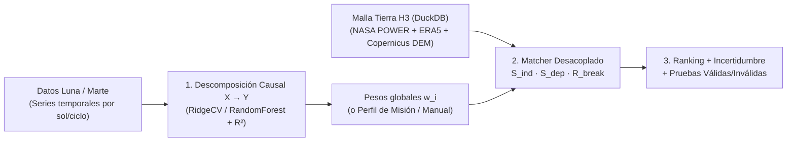

# Fuentes de Datos por API y Algoritmo de Matching (Tierra ↔ Luna / Marte) — Ckepi

Este documento detalla **qué datos exactos se obtienen de cada API externa**, qué variables se derivan o modelan físicamente y **cómo se emparejan (matchean)** las observaciones de la Luna y Marte contra las celdas hexagonales H3 de la Tierra.

---

## 1. APIs de Marte (`mars`)

| Fuente / API | Endpoint | Datos Crudos Obtenidos | Variables Generadas / Uso | Módulo |
|---|---|---|---|---|
| **NASA Mars MSL Curiosity REMS API** | `https://mars.nasa.gov/rss/api/?feed=weather&category=msl&feedtype=json` | `min_gts_temp`, `max_gts_temp`, `min_temp`, `max_temp`, `pressure` (Pa), `ls` (longitud solar), `sunrise`, `sunset`, `atmo_opacity`, `local_uv_irradiance_index`, `wind_speed`, `terrestrial_date` | `mean_surface_temp_k`, `diurnal_temp_amplitude_k`, `nocturnal_cooling_k_hr`, `atm_pressure_mbar` (`Pa/100`), `aeolian_dust_flux`, `uv_irradiance_index`, `surface_wind_ms`, `solar_flux_wm2` (vía `ls` y latitud), `thermal_inertia` | [mars_api.py](../backend/app/etl/mars_api.py) |
| **NASA Mars 2020 Perseverance MEDA API** | `https://mars.nasa.gov/rss/api/?feed=weather&category=mars2020&feedtype=json` | Soles recientes de Jezero Crater (`min_temp`, `max_temp`, `pressure`, `ls`, `atmo_opacity`, etc.) | Fuente principal para `mars_jezero_crater` (y sondeos cercanos); si devuelve `< 30` soles, complementa con la estacionalidad de REMS | [mars_api.py](../backend/app/etl/mars_api.py) |
| **NASA PDS Orbital Data Explorer (ODE)** | `https://oderest.rsl.wustl.edu/live2/` (`target=mars`, `ihid=MRO`, `iid=CRISM/SHARAD`) | Conteo de productos orbitales `TRDR` (CRISM) y `RGRAM` (SHARAD) en la vecindad de `(lat, lon)` | Alimenta el nivel de confianza (`DataConfidence.pds_products_found`) y trazabilidad de fuentes | [mars_api.py](../backend/app/etl/mars_api.py) |
| **MGS MOLA DEM (textura local)** | `planet_texture_mars_mars_mola.jpg` (cacheada desde NASA Mars Trek) | Matriz de elevación en escala de grises alrededor de `(lat, lon)` (ventana `3×3`) | `slope_deg` y `topographic_roughness` en sondeos libres (`POST /api/v1/planetary/probe`) | [planetary_probe.py](../backend/app/etl/planetary_probe.py) |
| **NASA Mars Trek WMTS** | `https://trek.nasa.gov/tiles/Mars/EQ/...` | Mosaicos globales `Mars_Viking_MDIM21_ClrMosaic_global_232m` y `Mars_MGS_MOLA_ClrShade_merge_global_463m` | Capas 3D del globo marciano vía proxy `/api/v1/tiles/trek/...` y `/api/v1/textures/planet/...` | [main.py](../backend/app/main.py) |

> **Nota de modelado:** Para sitios curados sin estación en superficie (`mars_arcadia_planitia`) o sondeos libres lejanos a Gale/Jezero, `ice_sublimation_rate` se calcula físicamente a partir de `subsurface_ice_frac` y `solar_flux_wm2`, y las fronteras de ruptura usan `gravity_g = 0.378` y `radiation_msv_yr = 230.0`.

---

## 2. APIs de la Luna (`moon`)

| Fuente / API | Endpoint | Datos Crudos Obtenidos | Variables Generadas / Uso | Módulo |
|---|---|---|---|---|
| **NASA PDS ODE — LRO Diviner** | `https://oderest.rsl.wustl.edu/live2/` (`target=moon`, `ihid=LRO`, `iid=DLRE`, `pt=PRP/GDR_L3`) | Metadatos de productos Diviner y fechas reales (`UTC_start_time`) en el área `(lat, lon)` | Ventana temporal de observación y conteo de productos PDS; la serie diurna de temperaturas se evalúa con modelo físico radiativo de **Stefan-Boltzmann** (`SOLAR_CONSTANT_1AU = 1361.0`, `emissivity = 0.95`) y `base_ti` | [moon_api.py](../backend/app/etl/moon_api.py) |
| **NASA PDS ODE — LRO LOLA & Mini-RF** | `https://oderest.rsl.wustl.edu/live2/` (`ihid=LRO`, `iid=LOLA/MRFLRO`) | Conteo de productos `RDR` (LOLA) y `MAP` (Mini-RF) cerca de `(lat, lon)` | Alimenta `DataConfidence.pds_products_found` y fuentes del sitio | [moon_api.py](../backend/app/etl/moon_api.py) |
| **LRO LOLA DEM (textura local)** | `planet_texture_moon_moon_lola.jpg` (cacheada desde NASA Moon Trek) | Matriz de elevación en escala de grises alrededor de `(lat, lon)` (ventana `3×3`) | `slope_deg` y `topographic_roughness` en sondeos libres (`POST /api/v1/planetary/probe`) | [planetary_probe.py](../backend/app/etl/planetary_probe.py) |
| **NASA Moon Trek WMTS** | `https://trek.nasa.gov/tiles/Moon/EQ/...` | Mosaicos `LRO_WAC_Mosaic_Global_303ppd_v02` y `LRO_LOLA_ClrShade_Global_128ppd_v04` | Capas 3D del globo lunar vía proxy `/api/v1/tiles/trek/...` y `/api/v1/textures/planet/...` | [main.py](../backend/app/main.py) |

> **Nota física lunar:** Al carecer de atmósfera, `surface_wind_ms = 0.0`, `aeolian_dust_flux = 0.0`, `relative_humidity_pct = 0.0`, `aridity_index = 1.0`, y las fronteras de ruptura son `gravity_g = 0.165`, `atm_pressure_mbar = 1e-12`, `radiation_msv_yr = 380.0`.

---

## 3. APIs de la Tierra (`earth`)

| Fuente / API | Endpoint | Datos Crudos Obtenidos | Variables Generadas / Uso | Módulo |
|---|---|---|---|---|
| **Open-Meteo Elevation (Copernicus 90m DEM)** | `https://api.open-meteo.com/v1/elevation` | Elevación en 5 puntos (centro ± `0.015°` en lat/lon, ~3.3 km) | `slope_deg` (diferencia finita central), `topographic_roughness` (desviación estándar normalizada) y `elevation_m` | [earth_api.py](../backend/app/etl/earth_api.py) |
| **OpenTopoData (NASA/METI ASTER 30m DEM)** | `https://api.opentopodata.org/v1/aster30m` | Elevación de respaldo si Open-Meteo devuelve límite de tasa (`429`/error) | Mismo cálculo de `slope_deg` y `topographic_roughness` | [earth_api.py](../backend/app/etl/earth_api.py) |
| **NASA POWER (Climatology & Daily)** | `https://power.larc.nasa.gov/api/temporal/climatology/point` (fallback `/daily/point`) | `ALLSKY_SFC_SW_DWN`, `ALLSKY_SRF_ALB`, `T2M`, `T2M_RANGE`, `PS`, `GWETTOP`, `WS10M`, `RH2M`, `ALLSKY_SFC_UV_INDEX`, `PRECTOTCORR`, `CLOUD_AMT`, `FROST_DAYS` | `solar_flux_wm2`, `surface_albedo`, `atm_pressure_mbar`, `aridity_index` (`1 - GWETTOP`), `surface_wind_ms`, `relative_humidity_pct`, `uv_irradiance_index`, `aeolian_dust_flux` (derivado de viento y aridez) | [earth_api.py](../backend/app/etl/earth_api.py) |
| **Open-Meteo Archive (ERA5 horario)** | `https://archive-api.open-meteo.com/v1/archive` | `temperature_2m`, `soil_temperature_0_to_7cm`, `soil_moisture_0_to_7cm`, `shortwave_radiation`, `et0_fao_evapotranspiration` | `diurnal_temp_amplitude_k`, `nocturnal_cooling_k_hr`, `mean_surface_temp_k`, `thermal_inertia` (inercia aparente), `subsurface_ice_frac`, `ice_sublimation_rate`, `vegetation_lai_proxy` | [earth_api.py](../backend/app/etl/earth_api.py) |
| **ISRIC SoilGrids v2.0** | `https://rest.isric.org/soilgrids/v2.0/properties/query` | `sand`, `clay`, `bdod`, `soc` (profundidad `0-5cm`) | Metadatos edáficos complementarios (`sand_pct`, `clay_pct`, `bdod_g_cm3`, `soc_pct`) | [earth_api.py](../backend/app/etl/earth_api.py) |
| **NASA Earthdata CMR** | `https://cmr.earthdata.nasa.gov/search/granules.json` | Gránulos `MOD11A1` (MODIS Terra LST) y `SPL3SMP` (SMAP Soil Moisture) | Catálogo multi-agencia por celda H3 (`GET /api/v1/earth/{h3_index}/datasets`) | [space_agencies_api.py](../backend/app/etl/space_agencies_api.py) |
| **ESA Copernicus Data Space (OData)** | `https://catalogue.dataspace.copernicus.eu/odata/v1/Products` | Escenas `SENTINEL-1` SAR y `SENTINEL-2` MSI que intersectan el punto | Catálogo multi-agencia por celda H3 | [space_agencies_api.py](../backend/app/etl/space_agencies_api.py) |
| **CSA Open Data & JAXA G-Portal** | `https://donnees-data.asc-csa.gc.ca/api/3/action/package_show` + enlace G-Portal | Datasets RADARSAT (CSA) y referencia regional GCOM-C/AMSR2 (JAXA) | Catálogo multi-agencia por celda H3 | [space_agencies_api.py](../backend/app/etl/space_agencies_api.py) |
| **Macrostrat API** | `https://macrostrat.org/api/v2/geologic_units/map` | `unit_name`, `lith`, `best_int_name` (edad geológica) | Geología local, detección de litología basáltica/kárstica (potenciales tubos de lava/cuevas) y perfil de habitabilidad | [geology_and_habitability.py](../backend/app/etl/geology_and_habitability.py) |

---

## 4. Cómo se Matchea Luna/Marte contra la Tierra

Todas las observaciones planetarias y cada celda hexagonal H3 terrestre se normalizan al mismo vector canónico de **19 variables físicas** definido en [config.py](../backend/app/config.py):

- **10 Variables Independientes ($X$ — Sustrato y Forzamiento):** `topographic_roughness`, `slope_deg`, `thermal_inertia`, `surface_albedo`, `solar_flux_wm2`, `subsurface_ice_frac`, `aridity_index`, `relative_humidity_pct`, `uv_irradiance_index`, `vegetation_lai_proxy`.
- **6 Variables Dependientes ($Y$ — Respuesta Ambiental):** `diurnal_temp_amplitude_k`, `nocturnal_cooling_k_hr`, `mean_surface_temp_k`, `surface_wind_ms`, `aeolian_dust_flux`, `ice_sublimation_rate`.
- **3 Variables de Ruptura ($B$ — Fronteras Irreproducibles):** `gravity_g`, `atm_pressure_mbar`, `radiation_msv_yr`.

### Flujo Paso a Paso del Matching

1. **Descomposición Causal en el Destino ([causal_decomposer.py](../backend/app/engine/causal_decomposer.py)):**
   - Para el sitio planetario elegido, se estandarizan $X$ e $Y$ (`StandardScaler`) y se entrena `RidgeCV` o `RandomForestRegressor` para cada variable dependiente $Y_k = f(X)$.
   - Las variables con $R^2 > 0.05$ aportan su vector de importancias ponderado por $R^2$, produciendo los pesos causales normalizados `global_iv_weights` ($w_i$). Si el usuario elige un perfil de misión (ej. *Movilidad de Rovers*, *ISRU Hielo*) o pesos manuales, [mission_advisor.py](../backend/app/engine/mission_advisor.py) sustituye $w_i$.

2. **Similitud Desacoplada por Variable y Capa ([analog_matcher.py](../backend/app/engine/analog_matcher.py)):**
   - Cada diferencia entre el sitio planetario ($p_i$) y la celda terrestre ($e_i$) se divide por su escala física $\sigma_i$ (`FEATURE_SCALES` en [config.py](../backend/app/config.py)):
     - **Sustrato Independiente ($S_{\text{ind}}$):**
       $$S_{\text{ind}} = \exp\left(-\sqrt{\sum_{i \in X} w_i \left(\frac{p_i - e_i}{\sigma_i}\right)^2}\right) \in (0, 1]$$
     - **Respuesta Ambiental ($S_{\text{dep}}$):**
       $$S_{\text{dep}} = \exp\left(-\sqrt{\sum_{k \in Y} w^{\text{dep}}_k \left(\frac{p_k - e_k}{\sigma_k}\right)^2}\right) \in (0, 1]$$

3. **Puntaje Combinado, Incertidumbre y Escala:**
   - **Puntaje combinado:** `combined_score = 0.60 * S_ind + 0.40 * S_dep`.
   - **Ajuste por confianza e incertidumbre:** Usando el índice de confianza del sitio planetario (`conf_score`), se calcula `confidence_adjusted_score = combined_score * (0.75 + 0.25 * conf_score)` y el margen de incertidumbre `score_uncertainty = (1.0 - conf_score) * 0.22`, junto con `confidence_interval` (`[combined_score - uncertainty, combined_score + uncertainty]`) y la escala espacial `effective_scale_km` según la resolución H3 (ej. `158.2 km` en Res 2, `59.8 km` en Res 3, `8.5 km` en Res 5).

4. **Frontera de Ruptura Física ($R_{\text{break}}$) y Recomendaciones ([mission_advisor.py](../backend/app/engine/mission_advisor.py)):**
   - Se compara `gravity_g`, `atm_pressure_mbar` (en escala logarítmica) y `radiation_msv_yr` entre el astro y la Tierra (`1.0 g`, `1013.25 mbar`, `2.4 mSv/año`).
   - Si el índice de ruptura supera `0.60`, se marca `is_broken = True` y el asesor clasifica qué pruebas de ingeniería son **válidas en campo terrestre** (ej. movilidad en pendiente/rugosidad, sensores ópticos/albedo, perforación en hielo) y cuáles son **inválidas al aire libre** (ej. aerodinámica de paracaídas en CO₂, enfriamiento convectivo en vacío, tolerancia a radiación cósmica).
