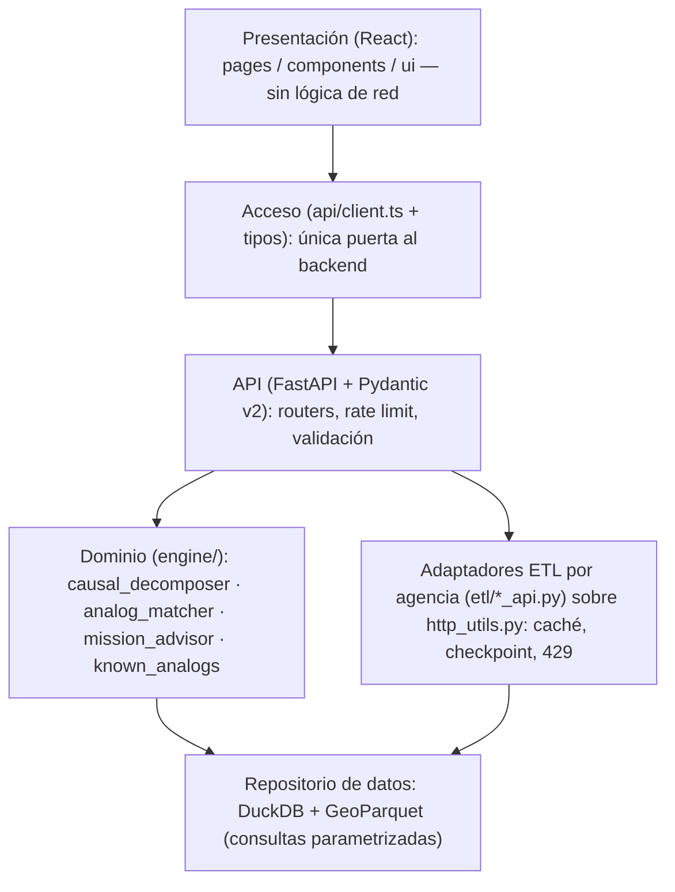

# Plan Global (Parte B · Misión) y Arquitectura — Ckepi

> Borrador de trabajo local. Mantiene el stack ya construido (FastAPI + DuckDB + React/Vite) y toma de `hackanasa` solo identidad, reglas y rúbrica. Complementa `docs/SDD.md`, que sigue siendo la fuente técnica.

## 1. Skills y agentes que vamos a usar

| Fase | Skill / agente | Para qué |
|---|---|---|
| Brief y alcance | `grill-me`, `mckinsey-space-apps`, agente `mckinsey-orquestador` | Congelar P0/P1/P2 con preguntas, no supuestos |
| Motor y datos | `ckepi-engine-change`, `tdd`, `diagnosing-bugs`, agentes `cientifico-lunar-artemis`, `geologo-marte-isru` | Cambios al matching con tests y revisión científica |
| Identidad, UI/UX | `frontend-design`, `better-layout`, `better-typography`, `better-colors`, `ckepi-ui-i18n` | Sistema visual papel-cartón y textos trilingües |
| Accesibilidad y motion | `better-accessibility` (WCAG 2.2, `prefers-reduced-motion`) + librería `motion` | No hay skill de motion dedicada instalada; el criterio lo ponen estas dos |
| Calidad | `ckepi-verify`, `webapp-testing`, `web-quality-audit`, `core-web-vitals`, `code-review` | Compuertas antes de dar algo por hecho |
| Ciencia abierta | `revisar-ciencia-abierta` (repo `Delnr91/nasa-ciencia-abierta`, se copia solo si hace falta) | Auditoría de FAIR, citas y reproducibilidad antes del envío |
| Envío | `validador-space-apps-2026`, agentes `juez-validador-space-apps-2026` y `abogado-del-diablo-juez-nasa`, `pitch-storytelling-space-apps` | Rúbrica, puertas duras, página en inglés y video de 30 s |

## 2. Orden de construcción (global primero, local preparado)

0. **Línea base:** correr `ckepi-verify` sobre lo que ya existe (pytest, build, paridad i18n). No se ha ejecutado aún.
1. **Scope freeze P0/P1/P2** (`grill-me`). P0 = flujo global funcionando y honesto.
2. **Tokens de identidad** en `tailwind.config.ts` / CSS: paleta y tipografías autoalojadas (Fontsource), claro/oscuro.
3. **Capa de honestidad científica visible:** incertidumbre, resolución H3, brecha B y fuente en cada resultado; back-testing contra los ~25 análogos de `known_analogs.py`.
4. **Experiencia Misión (global):** globo, ranking, diagnóstico, comparación, exportación; todo en `es`/`en`.
5. **Motion con función:** transiciones Luna↔Tierra↔Marte, capas que revelan datos, apagado con movimiento reducido.
6. **Capa Explorador (local), solo preparada:** modo STEAM ya existe; se reutiliza el mismo motor y los mismos tokens, sin construir más.
7. **Ciencia abierta:** `CITATION.cff`, `docs/DMP.md` (mini-OSDMP), una bibliografía única, `REFERENCES.md` completo, ejecutar `revisar-ciencia-abierta`.
8. **Envío:** `validador` modo pre-envío → página en inglés → video ≤30 s → `abogado-del-diablo` → "Submit for Judging" (límite dom 23:59 Chile; meta ≤20:00).

## 3. Identidad visual: papel-cartón por capas

- Concepto: cada capa de papel es una **curva de nivel real** (LOLA, MOLA, Copernicus DEM). El estilo es el dato, no decoración.
- Paleta (tokens semánticos con nombre físico): `papel-anortosita #E9E4D8`, `papel-basalto #3B3A3F`, `papel-oxido-marte #C1440E`, `papel-atacama #D9A066`, `papel-hielo #CFE3EA`, `papel-cielo-noche #0B1D3A`. Contraste WCAG AA; el color nunca es el único código.
- Tipografía: títulos **Space Grotesk**, datos **IBM Plex Mono** (Misión); **Atkinson Hyperlegible** + **Fraunces** para el modo Explorador. Todas autoalojadas.
- Arte propio en SVG. Prohibido insignia/logos NASA; todo raster generado con IA lleva marca de agua visible.
- Motion: ≤300 ms por microinteracción, solo si revela un dato; librería `motion` (MIT); sin GSAP (licencia no OSI).

## 4. Arquitectura por capas

**Capas de datos**
| Capa | Contenido | Dónde |
|---|---|---|
| L0 Crudo | Respuestas de NASA POWER, Open-Meteo, Copernicus DEM, PDS, Trek, Macrostrat | caché de `http_utils.py` + `era5_res3_checkpoint.jsonl` |
| L1 Normalizado | Celdas H3 con unidades SI y marcas de actualización | `ckepi.duckdb`, `earth_h3_grid.parquet` |
| L2 Características | Variables X (10), Y (6), B (3) y `FEATURE_SCALES` | `config.py` (única fuente de verdad) |
| L3 Resultados | Puntajes `S_ind`, `S_dep`, `R_break`, incertidumbre, ranking | `engine/` → esquemas Pydantic |
| L4 Procedencia | Fuente, resolución, licencia y cita de cada variable | `docs/DATA_PROVENANCE.md`, `REFERENCES.md` |
| L5 Salidas | CSV, GeoJSON, informe Markdown | `frontend/src/utils/exportResults.ts` |

## 5. Patrones de diseño

- **Ports & Adapters** por agencia: cada `etl/*_api.py` es un adaptador intercambiable.
- **Strategy** para las dimensiones de similitud y los perfiles de misión (Luna, Marte, manual).
- **Repository** sobre DuckDB: el motor no escribe SQL suelto.
- **Pipeline precalculado + cache-aside** para lo masivo (Res 2–3); refinamiento bajo demanda hasta Res 5.
- **Fuente única de verdad:** `config.py` ↔ `schemas.py` ↔ `types/analog.ts` ↔ claves i18n; se cambian juntos.
- **Facade** en `api/client.ts`; componentes presentacionales sin estado global innecesario.
- **Content as data:** textos en JSON i18n, catálogo de sitios en `planetary_sites.json`.

## 6. Stack (se mantiene) y brechas frente a hackanasa

Se conserva React 18 + Vite 5 + Tailwind 3 + MapLibre 6 + FastAPI + DuckDB. **No migrar a Astro/React 19/Tailwind 4 hoy**: reescribir lo ya hecho no suma puntos de rúbrica. Añadir solo: `motion`, Fontsource, `vitest` para el front y `ruff` para el back (opcionales).

## 7. Buenas prácticas

TDD en el motor; tests de contrato de la API; sin `any`; sin `style={{}}`; paridad i18n; `Intl.*`; consultas parametrizadas; rate limit; secretos solo en `.env`; `npm audit` y `pip-audit`; commits pequeños; PRs con `code-review`; cada dato nuevo con su fila en `DATA_PROVENANCE.md`.

## 8. Uso del repo `nasa-ciencia-abierta` (solo lo que pida la rúbrica)

Se usa como **auditor y plantilla**, no se vuelca en el producto: (a) skill `revisar-ciencia-abierta` antes del envío (*Validity*); (b) plantilla mini-OSDMP → `docs/DMP.md`; (c) criterios FAIR/citación para `REFERENCES.md`. Su contenido es CC BY 4.0: si se copia algo, citar «Ciencia abierta · apuntes educativos independientes, Delnr91 y colaboradores» con enlace. Los PDF de NASA/AGU que incluye **no** son suyos y no se copian. El módulo educativo completo queda para la Parte A, si hay tiempo.

## 9. Riesgos abiertos

- Idiomas: hackanasa decidió `es`/`en`/`zh`; Ckepi tiene `es`/`pt`/`en`. Hay que elegir uno (ver preguntas).
- La página y los materiales de envío deben estar en inglés.
- `hackanasa/` está vacío como submódulo: los enlaces de las skills copiadas no resuelven hasta inicializarlo.
- Estado de pytest y build sin verificar.
