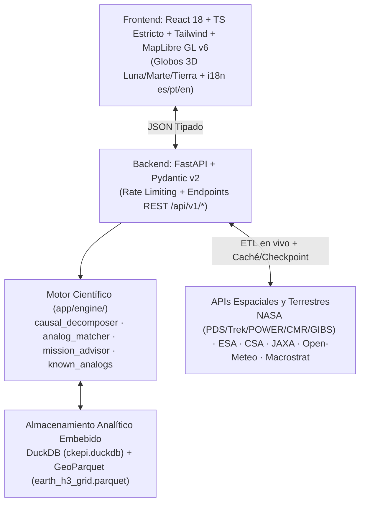

# Software Design Document (SDD) — Ckepi

**Versión:** 1.0  
**Proyecto:** Ckepi — Motor de Descubrimiento de Análogos Planetarios Terrestres mediante Descomposición Causal de Variables  
**Contexto:** NASA Space Apps Challenge 2026 (*Terrestrial Analogs for Moon & Mars*)  
**Documentos Relacionados:** [README.md](../README.md) · [DATA_PROVENANCE.md](DATA_PROVENANCE.md) · [AI_DISCLOSURE.md](../AI_DISCLOSURE.md) · [REFERENCES.md](../REFERENCES.md)

---

## 1. Propósito y Objetivos de Programación

### 1.1 Problema que Resuelve
Las misiones a la Luna y Marte requieren validar instrumentos, rovers y procedimientos en sitios terrestres análogos. Sin embargo, seleccionar sitios por similitud visual o promedios climáticos simples mezcla fenómenos físicos reproducibles con barreras físicas imposibles en la Tierra (gravedad reducida, vacío o atmósfera de $\text{CO}_2$, radiación cósmica galáctica).

### 1.2 Objetivos del Software
1. **Rigor Causal ($X \rightarrow Y$ y $B$):** Separar forzamientos geofísicos independientes ($X$), respuestas ambientales dependientes ($Y$) y límites físicos de ruptura ($B$) para responder **qué funciona, qué falla y por qué** en cada sitio terrestre.
2. **Descubrimiento Global sin Sesgo de Lista Fija:** Indexar la superficie terrestre mediante celdas hexagonales **H3 de Uber** y permitir *Modo Descubrimiento* (filtrando ~25 análogos clásicos conocidos) más **subdivisión jerárquica (*drill-down*) hasta Resolución 5**.
3. **Sondeo Planetario Interactivo en Vivo:** Permitir la exploración 3D de la Luna y Marte sobre capas **NASA Trek WMTS** con muestreo topográfico (LOLA/MOLA) y telemetría **NASA PDS ODE / REMS / MEDA**.
4. **Cero Costo de Infraestructura (Open-Source First):** Operar íntegramente con software libre (FastAPI, DuckDB, GeoParquet, React, MapLibre GL JS) y APIs científicas abiertas (NASA, ESA, CSA, JAXA, Open-Meteo, Macrostrat).

---

## 2. Lineamientos No Negociables de Ingeniería

Todo código nuevo o refactorizado en este repositorio **debe cumplir estrictamente** los siguientes lineamientos:

| Pilar | Regla Obligatoria en Ckepi |
|---|---|
| **1. Open-Source & Cost-Efficiency** | Priorizar librerías MIT/Apache 2.0 y almacenamiento embebido (**DuckDB + Parquet**). Aplicar caché agresivo y checkpoints incrementales para evitar agotar cuotas gratuitas (`HTTP 429`) de APIs externas. |
| **2. Diseño Responsive Multi-Dispositivo** | Interfaz *mobile-first* funcional desde `320px` hasta `4K+` (`1280px+`) sin desbordamientos. Todo botón, enlace o control interactivo debe respetar área táctil mínima de `44×44px` (`min-h-11` / `min-w-11` en Tailwind). |
| **3. Sistema de Diseño Unificado** | **Prohibido** usar `style={{ ... }}` con colores hexadecimales, píxeles fijos arbitrarios o sombras manuales. Usar exclusivamente tokens de Tailwind, variables CSS semánticas y los componentes base en `frontend/src/components/ui/` con soporte nativo Claro/Oscuro. |
| **4. Internacionalización (i18n)** | **Cero texto hardcodeado en UI o errores de usuario.** Toda cadena visible debe existir con paridad exacta **1:1** en `es.json`, `pt.json` y `en.json`, y las fechas/números deben formatearse con `Intl.DateTimeFormat` / `Intl.NumberFormat`. |
| **5. Precisión Numérica y Financiera** | Si se incorporan módulos financieros o de costos de misión, usar aritmética decimal exacta (sin `float`/`Number` sin control) y códigos ISO 4217 vía `Intl.NumberFormat`. En variables físicas, conservar unidades explícitas del SI y trazabilidad de procedencia. |
| **6. Tipado Estricto, Modularidad y Seguridad** | En TypeScript: **prohibido `any`** (usar interfaces estrictas en `src/types/` o `unknown` validado). En Python: **Pydantic v2** para validación en frontera, funciones pequeñas y reutilizables (principio DRY), consultas DuckDB parametrizadas y *rate limiting* en endpoints de sondeo en vivo. |

---

## 3. Arquitectura del Sistema



### 3.1 Responsabilidades por Módulo

- **Backend (`backend/app/`):**
  - [config.py](../backend/app/config.py): Definición canónica de variables $(X, Y, B)$, escalas físicas `FEATURE_SCALES` y parámetros de ejecución (`breakage_alert_threshold = 0.60`, `probe_rate_limit_per_min = 30`).
  - `engine/causal_decomposer.py`: Ajuste estadístico $X \rightarrow Y$ mediante `RidgeCV`, `RandomForestRegressor` y análisis de componentes principales (`PCA`).
  - `engine/analog_matcher.py`: Cálculo desacoplado de similitud de sustrato ($S_{\text{ind}}$), respuesta ambiental ($S_{\text{dep}}$) y ruptura física ($R_{\text{break}}$).
  - `engine/known_analogs.py`: Registro de ~25 sitios análogos clásicos para habilitar el filtrado del *Modo Descubrimiento*.
  - `engine/mission_advisor.py`: Generación de matriz de pruebas válidas/inválidas, límites terrestres y recomendaciones de exploración.
  - `etl/`: Conectores asíncronos/síncronos con manejo de errores, reintentos y respaldo seguro (`earth_api.py`, `global_earth_etl.py`, `mars_api.py`, `moon_api.py`, `planetary_probe.py`, `geology_and_habitability.py`, `space_agencies_api.py`).
- **Frontend (`frontend/src/`):**
  - `pages/ExplorerPage.tsx`: Orquestador de estado de búsqueda, selección de cuerpo/ROI, perfiles de prueba (Luna/Marte), pesos manuales y sondeo.
  - `components/map/`: `PlanetaryMap.tsx` (globo 3D Luna/Marte con NASA Trek WMTS) y `AnalogMap.tsx` (globo 3D Tierra + polígonos H3 + paginación numerada + drill-down).
  - `components/decomposition/`, `components/mission/`, `components/ui/`: Presentación desacoplada de lógica de red, usando `api/client.ts` y `types/analog.ts`.

---

## 4. Modelo Científico de Variables ($X, Y, B$)

Definido en [config.py](../backend/app/config.py) y documentado en [DATA_PROVENANCE.md](DATA_PROVENANCE.md):

| Capa | Variables | Rol en el Motor |
|---|---|---|
| **Independientes ($X$)** *(10)* | `topographic_roughness`, `slope_deg`, `thermal_inertia`, `surface_albedo`, `solar_flux_wm2`, `subsurface_ice_frac`, `aridity_index`, `relative_humidity_pct`, `uv_irradiance_index`, `vegetation_lai_proxy` | Definen el sustrato físico y forzamiento externo. Alimentan el modelo causal y el puntaje $S_{\text{ind}}$. |
| **Dependientes ($Y$)** *(6)* | `diurnal_temp_amplitude_k`, `nocturnal_cooling_k_hr`, `mean_surface_temp_k`, `surface_wind_ms`, `aeolian_dust_flux`, `ice_sublimation_rate` | Respuestas climáticas/dinámicas explicadas por $X$ ($R^2$ por variable) y evaluadas en $S_{\text{dep}}$. |
| **Ruptura Física ($B$)** *(3)* | `gravity_g`, `atm_pressure_mbar`, `radiation_msv_yr` | Fronteras físicas irreproducibles al aire libre en la Tierra. Si $R_{\text{break}} \ge 0.60$, se dispara alerta automática de invalidez experimental. |

---

## 5. Estrategia Espacial H3, Caché y Resiliencia ante APIs Externas

1. **Malla Base Pre-hidratada (H3 Res 2):** La base [ckepi.duckdb](../backend/app/data/ckepi.duckdb) y [earth_h3_grid.parquet](../backend/app/data/earth_h3_grid.parquet) almacenan las celdas continentales globales junto con marcas temporales de actualización para responder búsquedas en milisegundos sin depender de red.
2. **Drill-Down Bajo Demanda (Res 3 → Res 5):** Al subdividir un hexágono (`POST /api/v1/analogs/refine`), se calculan sus 7 hijos con `h3.cell_to_children`, se consultan las APIs en vivo y se persisten en DuckDB para reutilización futura.
3. **Checkpoints ETL:** Los procesos masivos (`global_earth_etl.py`) escriben progreso incremental (`era5_res3_checkpoint.jsonl`) para reanudar limpiamente tras límites de tasa (`HTTP 429`).
4. **Proxy de Tiles y Texturas:** El backend actúa como proxy seguro en `/api/v1/tiles/trek/{body}/{z}/{y}/{x}.jpg` y `/api/v1/textures/planet/{body}/{layer}.jpg` para evitar problemas de CORS y cachear texturas localmente.

---

## 6. Contratos de API REST (`FastAPI`)

| Método y Ruta | Propósito | Protección / Validación |
|---|---|---|
| `GET /api/v1/health` | Salud del servicio y conteo de celdas H3 en DuckDB | Sin auth |
| `GET /api/v1/planetary-sites` | Catálogo curado de sitios objetivo en Luna y Marte | Esquema `PlanetarySite` |
| `POST /api/v1/decompose` | Descomposición causal $X \rightarrow Y$, PCA y perfil $B$ | Pydantic v2 |
| `POST /api/v1/analogs/search` | Ranking global de análogos con pesos automáticos, perfiles o manuales | Pydantic v2 |
| `POST /api/v1/analogs/refine` | Subdivisión H3 en 7 sub-hexágonos (hasta Res 5) | Validación H3 + Rate Limit |
| `POST /api/v1/planetary/probe` | Sondeo libre `(lat, lon)` en Luna o Marte | Rate Limit (`30/min`) |
| `POST /api/v1/earth/probe` | Sondeo libre terrestre e inserción en DuckDB | Rate Limit (`30/min`) |
| `GET /api/v1/analogs/{h3_index}/compare/{site_id}` | Comparación variable por variable | Validación H3 + 404 ROI |
| `GET /api/v1/earth/{h3_index}/datasets` | Catálogo NASA/ESA/CSA/JAXA + Macrostrat + tubos de lava + habitabilidad | Validación H3 |
| `POST /api/v1/datasets/refresh` | Re-materialización de datasets | Dependencia `_verify_admin_token` |

---

## 7. Estándares de Verificación y Calidad (Definition of Done)

Ningún cambio se considera terminado hasta superar todas las compuertas aplicables:

1. **Backend:**
   ```bash
   cd backend
   # macOS / Linux:
   .venv/bin/python -m pytest -q
   # Windows PowerShell:
   .\.venv\Scripts\python.exe -m pytest -q
   ```
   *(Las pruebas unitarias de motor causal, matcher y validación deben pasar al 100%; las pruebas que dependen de Open-Meteo Archive en vivo deben contemplar manejo ante `HTTP 429`.)*
2. **Frontend (Compilación y Tipado Estricto):**
   ```bash
   cd frontend
   npm run build
   ```
   *(Debe ejecutar `tsc && vite build` con `0` errores y cero usos de `any`.)*
3. **Paridad Internacionalización (`es` / `pt` / `en`):**
   - Verificar que `en.json`, `es.json` y `pt.json` contengan exactamente el mismo conjunto de claves (`diff = set()`).
4. **Verificación Visual y Responsive:**
   - Inspeccionar en navegador (o captura headless CDP) que no existan desbordamientos en móvil (`320px`) ni escritorio (`1280px+`), que los globos WebGL MapLibre rendericen sin errores de consola y que los botones mantengan `min-h-11`.

---

## 8. Checklist Rápido para Nuevas Funcionalidades

- [ ] ¿Se reutilizaron componentes de `components/ui/` y tokens Tailwind sin `style={{ ... }}`?
- [ ] ¿Se agregaron las claves de traducción simultáneamente en `es.json`, `pt.json` y `en.json`?
- [ ] ¿Están tipados todos los esquemas en `schemas.py` (Pydantic v2) y `types/analog.ts` (sin `any`)?
- [ ] ¿Se documentó en [DATA_PROVENANCE.md](DATA_PROVENANCE.md) si se añadió una nueva variable o fuente satelital?
- [ ] ¿Se ejecutaron `pytest`, `npm run build` y la verificación de paridad i18n tras la última edición?

---

## 9. Cumplimiento NASA Space Apps Challenge 2026

Para garantizar elegibilidad global y máximo puntaje en los 5 criterios (*Impact, Creativity, Validity, Relevance, Presentation*):

1. **Puertas Duras de Elegibilidad:**
   - Proyecto público sin login requerido en demo en vivo.
   - Licencia OSI explícita (**Apache-2.0** en [LICENSE](../LICENSE)).
   - Declaración transparente de herramientas de IA ([AI_DISCLOSURE.md](../AI_DISCLOSURE.md)), sin marcas/logos NASA en contenido generado por IA.
   - Fuentes completas registradas en [REFERENCES.md](../REFERENCES.md) y visibles directamente en las vistas de resultados de la interfaz.
2. **Política de Fuentes Científicas:**
   - Núcleo alimentado exclusivamente por datasets abiertos de **NASA** (PDS, LRO LOLA, MRO/MSL, POWER, Earthdata CMR, Trek WMTS) y agencias socias (**ESA Copernicus**, **CSA**, **JAXA**), más **Open-Meteo** y **Macrostrat**. No se consumen APIs ni portales de CNSA.
3. **Honestidad Científica y Alcance:**
   - Cada puntaje de similitud ($S_{\text{ind}}$, $S_{\text{dep}}$) expone su margen de incertidumbre (`score_uncertainty` / intervalo estimado), su resolución espacial efectiva (H3 Res 2–5) y la **Brecha Física Irreducible ($B$)** (gravedad, atmósfera, radiación, temperatura).
   - **Ckepi preselecciona sitios para ensayos de campo; no certifica seguridad operativa.**
4. **Impacto STEAM y Local:**
   - La interfaz ofrece un selector entre **Modo Misión** (rigor técnico completo) y **Modo Explorador / STEAM** (lectura clara sin jerga para estudiantes y comunidades).

