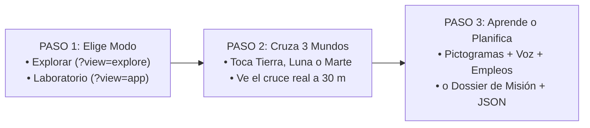

# Ckepi — Resumen Simplificado en 1 Página (Para Mentores y Jurado)

> **En 1 frase:** Ckepi cruza **4 zonas reales de Antofagasta** con **la Luna y Marte a 30 m de resolución**, diciendo con números exactos **qué sí sirve para entrenar misiones (suelo y clima)**, **qué es físicamente imposible en la Tierra (gravedad, vacío y radiación)** y **en qué trabajos reales de Antofagasta puedes aplicar esto hoy**.

---

## 1. El Problema y Nuestra Solución (Sin Rodeo)

| Antes (El Problema) | Ahora con Ckepi (La Solución) |
|---|---|
| Se dice *"Atacama es igual a Marte"*, pero se mezclan fotos de distintas escalas y se olvida que en la Tierra hay aire y gravedad $1g$. | Comparamos **a la misma escala ($30\text{ m}$)** y separamos **lo que sí se parece ($\mathbf{X}, \mathbf{Y}$)** de **lo que jamás se parecerá ($\mathbf{B}$)**. |

---

## 2. Los 4 Lugares de Antofagasta que Medimos (Escala $30\text{ m}$)

| Zona en Antofagasta | Con qué se cruza | Puntaje ($30\text{ m}$) | ✅ Qué SÍ se parece | ❌ Qué NO se parece |
|---|---|---:|---|---|
| **1. Valle de la Luna** | **Cráter Jezero (Marte)** | **0.88** (`[0.86, 0.89]`) | Pendiente ($8.3^\circ$ vs $8.2^\circ$), cuencas y costras de sal/arcilla | En Valle de la Luna la sal es **cloruro (halita)**; en Jezero son **carbonatos y sulfatos** |
| **2. Yungay** | **Oxia Planum (Marte)** | **0.82** | Hiperaridez extrema, polvo fino oxidado y radiación UV alta | Pendiente más suave en Oxia ($3.9^\circ$ vs $6.8^\circ$) |
| **3. Salar de Atacama** | **Gale · Vera Rubin (Marte)** | **0.83** | Evaporitas de sulfato y polígonos de sal | El salar es plano ($2.1^\circ$); la cresta Vera Rubin tiene $9.4^\circ$ |
| **4. Volcán Llullaillaco** | **Polo Sur Lunar (Shackleton)** | **0.69** | Taludes empinados ($>18^\circ$) y roca volcánica desnuda | En la Luna hay **vacío total ($0\text{ kPa}$)**, polvo vítreo abrasivo y noches de 14 días |

---

## 3. El Límite Físico $\mathbf{B}$ (Lo que la Tierra NUNCA puede imitar)

Siempre mostramos una alerta roja para no engañar a ingenieros ni estudiantes:
- **Gravedad:** Tierra $1.00g$ vs **Marte $0.38g$** y **Luna $0.166g$** $\to$ cambia el peso, tracción y hundimiento de ruedas.
- **Atmósfera:** Tierra $101.3\text{ kPa}$ ($\text{N}_2/\text{O}_2$) vs **Marte $0.6\text{ kPa}$ ($\text{CO}_2$)** y **Luna $0\text{ kPa}$ (vacío)** $\to$ los motores se enfrían por aire en Atacama, pero se recalientan en el espacio.
- **Radiación:** Tierra $<3\text{ mSv/año}$ vs **Espacio $230\text{--}380\text{ mSv/año}$** $\to$ exige electrónica tolerante a radiación (*rad-hard*).
- **Temperatura ($\Delta T$):** Tierra $\sim 35\text{ K}$ vs **Marte $\sim 90\text{ K}$** y **Luna $\sim 290\text{ K}$**.

---

## 4. Cómo Funciona la App en 3 Pasos Simples

1. **Modo Explorar (`?view=explore` — Público, Estudiantes y Demo en 1 clic):**
   - Muestra **3 mundos flotantes** (*Tierra · Antofagasta*, *Luna · Polo Sur*, *Marte · Jezero y Oxia*).
   - Tocas un mundo $\to$ ves **4 tarjetas simples** (*Qué sí se parece*, *Qué nunca se parecerá*, *Lección con pictogramas + voz*, y *3 empleos reales en Antofagasta*).
   - **Funciona en $<50\text{ ms}$ incluso sin internet/backend** gracias a snapshots reales precalculados (`frontend/public/data/local/`).
2. **Modo Laboratorio (`?view=app` — Ingenieros e Investigadores):**
   - Pantalla **«Tres Mundos»** + **Mapa 3D MapLibre + H3** + **4 pestañas**:
     1. **Comparar:** mapa + barras $\mathbf{X}/\mathbf{Y}$ + alerta $\mathbf{B}$.
     2. **Aprender:** lecciones paso a paso y casos negativos.
     3. **Planificar:** genera **Dossier de Misión** para validar rovers o sensores en Antofagasta.
     4. **Evidencia:** histogramas a $30\text{ m}$ ($W_1$, $D_{\text{KS}}$, IC 95 %) y descarga **JSON FAIR (`SPD-41a`)**.

---

## 5. Los 4 Ejes de Caja La Araucana + Empleo Local + ODS ONU

1. **Ciencia de Frontera:** Posiciona a Antofagasta como laboratorio planetario natural medido con datos NASA/ESA/Copernicus a $30\text{ m}$.
2. **Educación STEAM y Empleabilidad Joven:** Conecta cada zona con **3 sectores reales donde trabajar en Antofagasta hoy**:
   - **Robótica y automatización minera** (camiones autónomos, LiDAR y teleoperación en polvo/pendiente).
   - **Observatorios astronómicos (Paranal / ALMA)** (óptica, instrumentación y mecatrónica en cielo seco).
   - **Energía solar del desierto** (paneles fotovoltaicos y almacenamiento térmico bajo alta radiación UV).
3. **Aplicación Local (Minería, Agua y Municipio):** El mismo motor audita taludes mineros, cuencas evaporíticas y rutas críticas sin red celular.
4. **Red Interregional y ODS:** Une Antofagasta con el resto de Chile y el mundo bajo **ODS 4** (Educación), **ODS 8** (Trabajo Decente), **ODS 9** (Innovación), **ODS 13** (Clima) y **ODS 17** (Datos Abiertos).

---

## 6. Guion de 30 Segundos (Para Decir de Memoria)

- **0–7 s (Problema):** *"Decir que Atacama es igual a Marte sin separar qué sí se parece y qué no puede hacer fallar un rover."*
- **7–15 s (Solución):** *"Con Ckepi eliges Valle de la Luna, Yungay, Salar de Atacama o Llullaillaco y lo cruzas a 30 metros reales con Jezero o el Polo Sur Lunar."*
- **15–23 s (Demostración):** *"En un clic ves que Valle de la Luna calza un 88 % en topografía con Jezero, pero su sal es halita y jamás imitará el 0.38 g ni el vacío marciano."*
- **23–30 s (Impacto en Antofagasta):** *"Así entrenamos rovers con honestidad física y conectamos a jóvenes de Antofagasta con empleos reales en robótica minera, astronomía y energía solar."*

---

## 7. Regla Rápida de IA y Marca (Cumplimiento NASA `G11`)

- **Cero logos de NASA** en diapositivas, web o video.
- **Marca de agua visible obligatoria** en fondos e ilustraciones con IA: `"AI-generated background & symbol · Ckepi"`.
- **Lámina final de créditos + `AI_DISCLOSURE.md`:** declara que la ciencia y el motor estadístico son **100 % humanos**, y que la IA solo asistió en código, fondos ilustrados (con marca de agua) y voz/video.
